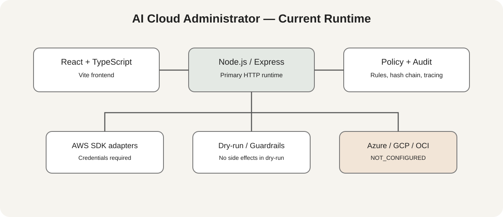

# Trimindslabs AI Cloud Administrator

MVP for multi-cloud administration, inventory, governance, observability, audit trails, and AI-assisted operations. This README describes the current primary runtime, not every auxiliary artifact in the repository.

## Current runtime

- Frontend: React 19, TypeScript, Vite.
- Primary HTTP runtime: Node.js / Express; frontend and API are served by the same process.
- Authentication: in-memory sessions; restart or instance replacement loses session state.
- Internal governance rules for resource and IaC evaluation.
- Audit integrity via SHA-256 hash chaining and integrity verification.
- Internal operation tracing.
- AI responses do not implicitly execute infrastructure changes.

A legacy/auxiliary Spring Boot backend exists in the repository. The root Docker/build path and primary runtime described here use Node/Express; Spring Boot code does not mean it is the active Cloud Run runtime. ADRs must identify whether Spring Boot is historical, auxiliary, or a future target.

## Provider capability status

| Provider / capability | Status in this version |
|---|---|
| AWS health probe, EC2 discovery/actions | Implemented through AWS SDKs when valid credentials and permissions are configured |
| Azure lifecycle/health adapter | NOT_CONFIGURED |
| GCP lifecycle/health adapter | NOT_CONFIGURED |
| OCI lifecycle/health adapter | NOT_CONFIGURED |
| IaC policy/validation | Implemented |
| Terraform/native IaC execution | Not connected |
| Cross-cloud backup/DR | No real provider/storage adapter or persistent scheduler |
| Inventory, sessions, audit state | In-memory; not durable across restart/scale |
| OPA Gatekeeper | Not integrated; local policy engine is not OPA |
| MCP | Configuration artifacts do not prove an independently running FastMCP server |

The demo identity demo/demo is available only when DEMO_MODE=true and is read-only. Do not enable demo mode as a production authentication strategy.

## Execution semantics

- AI response: advisory output; no infrastructure mutation.
- Dry-run: produces a plan without provider side effects.
- Real execution: possible only through a configured real adapter and permitted credentials.
- Missing adapter: report NOT_CONFIGURED; do not simulate successful provider operations.
- Critical destructive action: requires configured critical-execution permission and applicable approval guardrails.

## Architecture

    React / TypeScript / Vite
              |
              v
    Node.js / Express API
       |         |         |
       v         v         v
    AWS SDK   Policy     SHA-256 audit chain
    adapters  engine    + internal telemetry

    Azure / GCP / OCI: NOT_CONFIGURED

## Local development and validation

Use the Node.js version supported by the lockfile and package configuration.

    npm install
    npm run dev
    npm test
    npm run lint
    npm run build

Production process (does not itself deploy to Cloud Run):

    npm run build
    NODE_ENV=production npm start

The application reads PORT and binds to 0.0.0.0 for container compatibility. The root Dockerfile exists, but a Dockerfile or successful CI run is not proof of a current Cloud Run deployment. Verify deployed image digest, commit, revision, traffic, service account, secrets, and health endpoints before claiming a release is live.

## Configuration and security

Supply administrative credentials, GEMINI_API_KEY, and AWS credentials through deployment environment or Secret Manager as appropriate. Never place secrets in source control or frontend variables. Use least-privilege provider permissions. Sessions, inventory, and audit records currently lack durable external persistence.

## Documentation

- [Architecture diagram](./docs/diagrams/ai-cloud-administrator-architecture.svg)
- [ADRs](./docs/adr/) — distinguish current Node/Express runtime from auxiliary Spring Boot code.
- Deployment claims must cite a verifiable workflow run and deployed Cloud Run revision.

## Before production promotion

1. Decide and record the supported primary runtime (Node/Express or Spring Boot).
2. Verify the exact image digest and commit associated with any existing Cloud Run service.
3. Move sessions, inventory, and audit history to durable storage if restart/scale survival is required.
4. Validate AWS with least-privilege credentials; keep other providers NOT_CONFIGURED until real adapters are tested.
5. Run post-deployment smoke tests against the deployed revision.
